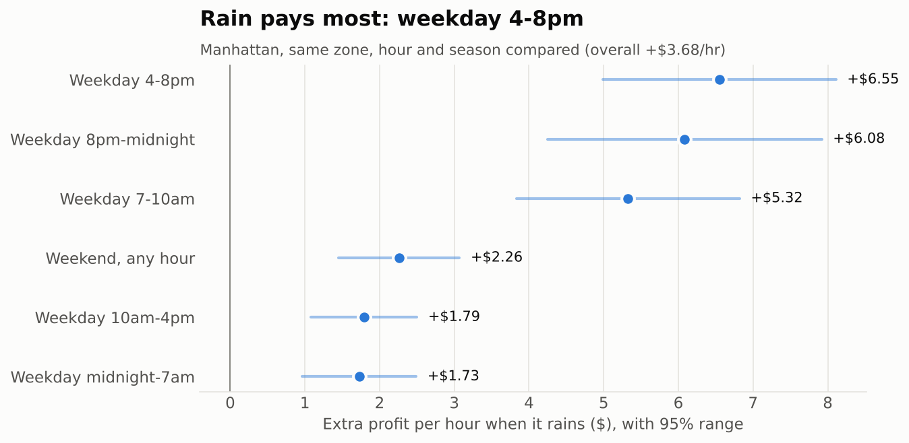

# Rideshare Profit Forecast (NYC)

**Question:** Where and when should a rideshare driver work tomorrow to make the most money, given the weather?

A weather-aware forecast of driver *profit* per hour (pay + tips minus driving costs and empty time),
by zone and hour, for Manhattan, JFK and LaGuardia. Built entirely on public data. Chicago follows as a
generalization test.

## Status
- [x] Plan and tools
- [x] Trips summarized to zone x hour, Jan 2024 to Aug 2026 (`pipeline/01_trips.py`)
- [x] Weather, actual and day-ahead forecast (`pipeline/02_weather.py`)
- [x] Weather, calendar, holidays and gas joined (`pipeline/03_features.py`)
- [x] Profit per hour, best / mid / worst case, with empty time that moves with how busy each zone
  and hour is (`pipeline/04_profit.py`)
- [x] Inflation (Aug 2026 dollars), rule-change markers and a time trend (`pipeline/03_features.py`)
- [x] Maps and charts of best zones and hours (`pipeline/05_explore.py`, `figures/`)
- [x] Weather regression with 95% ranges (`pipeline/06_regression.py`, `reports/regression_weather.txt`)
- [ ] Random forest / XGBoost
- [ ] Forecast backtest on 2026
- [ ] Map dashboard and "plan tomorrow"

## Run it
```
pip install -r requirements.txt
python pipeline/01_trips.py 2024-01 2026-08
python pipeline/02_weather.py 2024-01-01 2026-08-31
python pipeline/03_features.py
python pipeline/04_profit.py
python pipeline/05_explore.py
python pipeline/06_regression.py
python pipeline/07_dashboard_data.py
```

## First findings (Manhattan, middle-case assumptions, Aug 2026 dollars)
- A driver clears about $21 an hour after car costs; Midtown pays most, upper Manhattan least.
- Rain adds about $3.68 an hour (+18%, 95% range $3.05 to $4.31), up to $6.55 on weekday 4 to 8 pm.
  If rain doesn't shorten drivers' waits between rides, the effect is smaller: $1.36.
- Very hot (above 85F) and freezing hours also pay more; wind makes no difference.
- An airport pickup beats Manhattan until the taxi-lot wait passes about 83 minutes.



## Data in this repo
- `data/clean/zone_hour/YYYY-MM.parquet`: one row per pickup zone, hour and company (HV0003 Uber,
  HV0005 Lyft) with trips, driver pay, tips, miles, time with a rider, speed, rider wait and fare.
  Manhattan's 67 zones plus JFK (132) and LaGuardia (138). About 266 million trips in total.
- `data/clean/weather_actual.parquet`: hourly NWS readings at Central Park, JFK and LaGuardia
  (temperature F, precipitation inches, wind mph, rain and snow flags).
- `data/clean/weather_forecast_d1.parquet`: what the forecast said the day before, for the same hours.
- `data/clean/model_table.parquet`: the table the models use. One row per zone per hour (Uber + Lyft
  combined) with weather, forecast, calendar, holiday, gas price and profit per hour under best, mid
  and worst case assumptions. Main target: `profit_hr_busy_mid`. Use rows with `enough_trips == 1`. Too big for GitHub, so rebuild it
  with steps 03 and 04 (under a minute).

## Sources
NYC TLC High Volume FHV trip records, NWS station readings (via Iowa Environmental Mesonet),
Open-Meteo Previous Runs forecasts,
National Weather Service API, IRS 2026 mileage rate (72.5 cents/mile), EIA gas prices.
